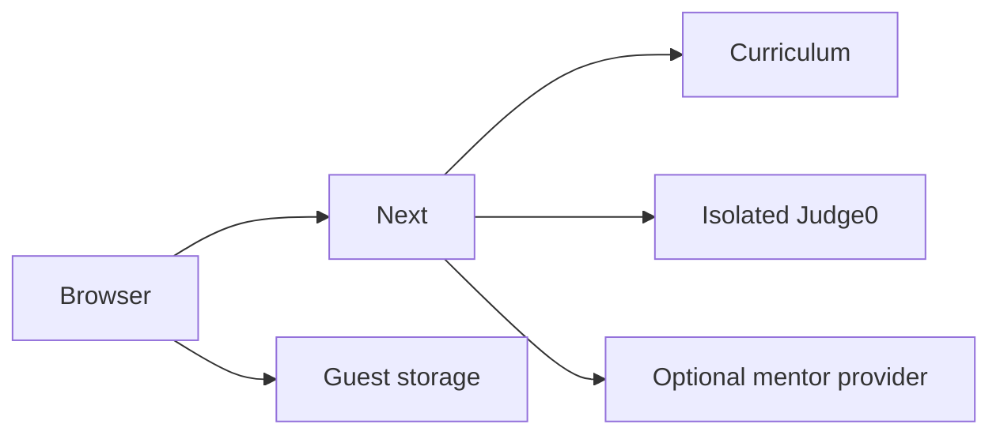

# AlgoAscend development plan

## Product specification

A learner can open a real experiment from the home page, predict the next action, inspect a trace generated from their input, and apply that reasoning to a coding problem. A guest chooses C, Python, or Java, an experience level, a daily time budget, and a goal. The roadmap recommends the next available lesson and shows the scope of the catalog. Progress is kept on the device in the first release slice.

## Architecture

Next.js App Router and React serve the public and guest experiences. TypeScript modules generate deterministic algorithm frames and define curriculum records, problems, and hint ladders. The judge API uses a server-only adapter for a separately managed Judge0 service. Learner programs never run in the Next.js process. An optional server-side mentor provider complements authored hints. A future FastAPI/PostgreSQL service can own synchronized identity and progress once the guest learning contract is stable.

## Database schema for account synchronization

| Table | Primary key | Fields and relationships |
| --- | --- | --- |
| users | user_id | unique email, created_at, password_hash when applicable |
| identities | provider, external_id | user_id references users |
| profiles | user_id | language, goal, experience, daily_minutes |
| concepts | concept_id | slug, stage, title, content_version |
| prerequisites | concept_id, required_concept_id | both reference concepts |
| lesson_progress | user_id, concept_id | completed_at, last_attempt_at, quiz_score |
| submissions | submission_id | user_id, problem_id, language, verdict, created_at |
| mistakes | mistake_id | user_id, optional submission_id, category, notes, review_at |
| contest_attempts | attempt_id | user_id, contest_id, started_at, finished_at |

Guest data is versioned and local. The account service must enforce ownership on each mutation. Hidden cases remain server-side and their contents are suppressed in responses.

## Design system

A midnight technical field guide. Geist and Geist Mono set the hierarchy. Indigo identifies actions and current frames. Cyan identifies the trace and emerald identifies completion. Warm labels distinguish learning milestones. Use a dotted coordinate grid where it explains an interface, hairline separators, modest radii, system-aware light and dark tokens, keyboard-visible focus, 44 px controls, and reduced-motion handling. The live chart is the landing illustration. Its input, active midpoint, eliminated window, and playback controls are usable immediately.

## Milestones and acceptance

1. Research and specification. Record learning mechanics, original interaction direction, schema and boundaries.
2. Trace engine. Validate sorted/unsorted input, duplicates, missing targets, and correct sort output at the trace API.
3. Guest learning. Verify onboarding, roadmap, keyboard playback, answer feedback, and progress after reload in a browser.
4. Practice. Verify editor, drafts, hints, and judge request validation. Test all three runtimes and isolation against an actual configured judge before judging release-ready.
5. Complete additional curriculum stages and visualization families. Each lesson requires explanations, examples, exercises, implementations and a verified reference.
6. Add accounts, database migrations, synchronization, adaptive review, mentor providers, contest simulations, integrations and analytics.
7. Verify the release with build, lint, types, automated browser and accessibility checks, pinned infrastructure, and a deployment smoke test.
