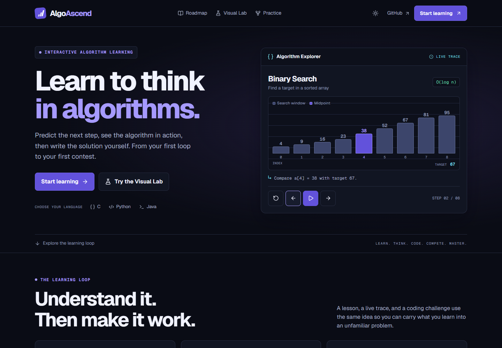

# AlgoAscend

**Learn. Think. Code. Compete. Master.**

AlgoAscend is an interactive programming field guide for learners working in C, Python, and Java. **Predict → Trace → Implement** connects a concrete decision to its algorithm state and a practice problem.



[Open AlgoAscend online](https://algoascend.vercel.app) · [Deployment and verification](docs/DEPLOYMENT.md)

## Run locally

Requires Node.js 22.18 or newer and npm.

```sh
npm ci
npm run dev
```

Open [localhost:3000](http://localhost:3000). Guest onboarding, four interactive lessons, the full curriculum roadmap, three visual traces, and four original coding problems work without an account or service credentials. This browser stores your progress, editor drafts, and notes.

## Learn by doing

- **Start** chooses a language, experience level, goal, and daily time budget.
- **Roadmap** recommends the next published lesson and marks completed lessons.
- **Visual Lab** walks through first-occurrence binary search, bubble sort, and running totals. Edit the array, step through pseudocode, and compare binary and linear search on the same input.
- **Pattern Detective** gives feedback on an approach and shows counterexamples for tempting alternatives. [See a worked case](docs/screenshots/pattern-detective.png).
- **Practice** includes a locally served Monaco editor, a plain-text editor, a resizable workspace, individual drafts, notes, progressive hints, and opt-in editorials.
- **Revision** schedules reviews from prediction results. The mistake notebook records missed predictions and failed submissions and lets learners add their own explanation.
- **External practice** links to five official platforms with manual completion, and reads recent Codeforces ratings from the public API.

## Run code locally

Use Docker to run and submit C, Python, and Java from the workspace. Start with the [local runner setup](docs/LOCAL_RUNNER.md).

## Connect an isolated Judge0 instance

Copy `.env.example` to `.env.local`. Set `JUDGE0_URL` to a privately managed Judge0 CE endpoint, optionally set its authentication token, and verify the configured language IDs with that installation. The adapter uses synchronous submissions and requires the instance to support `wait=true`. Restart the application after changing configuration.

Use a separately managed execution environment and restrict application access to the judge. Enforce isolation, networking, resource limits, and quotas at the judge or gateway. The process-local request limit is a development guard. The exact runtime verdicts depend on the installed judge. The browser sends source code only when a learner selects Run or Submit. Guest users can edit and save code when the judge is unavailable.

## Optional AI guidance

Configure AlgoMentor for short, problem-specific explanations with an OpenAI-compatible provider. Authored hints are always available. See the [mentor setup](docs/MENTOR.md).

## Verify

```sh
npm run lint
npm run typecheck
npm run test:coverage
npm run build
npx playwright install chromium
npm run test:e2e
```

Reference examples can be compiled and run with npm run test:reference. Use a Visual Studio Developer Command Prompt on Windows. Linux expects cc, python3, and a JDK on PATH.

- [Research and design decisions](docs/RESEARCH.md)
- [Architecture, account schema, and roadmap](DEVELOPMENT_PLAN.md)
- [Execution API and verification](docs/EXECUTION.md)
- [Current implementation and remaining work](PROGRESS.md)

## Contribute

See [CONTRIBUTING.md](CONTRIBUTING.md), the [code of conduct](CODE_OF_CONDUCT.md), and the [security policy](SECURITY.md). AlgoAscend is available under the MIT License.
